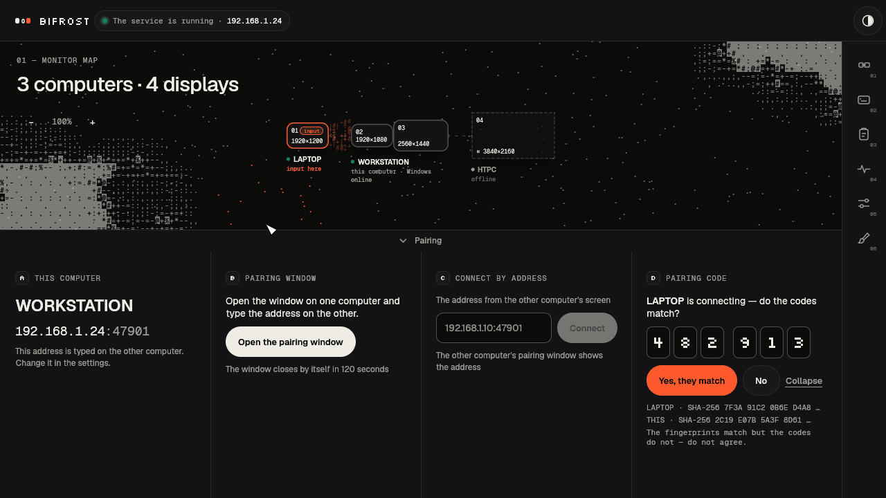
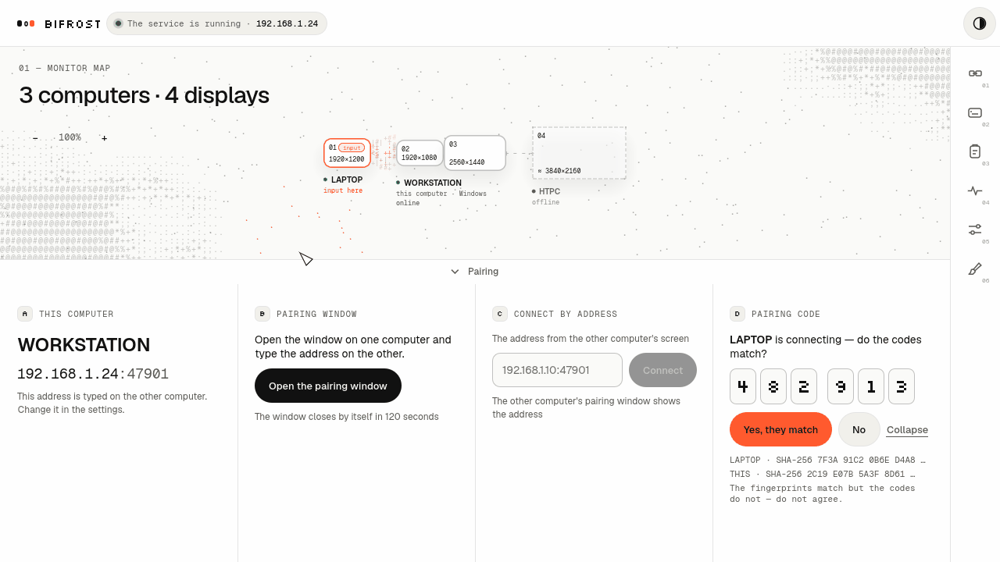

# Bifrost

**A rainbow bridge between your computers.**

Bifrost is a software KVM: share one keyboard, mouse and text clipboard across Windows and Linux computers on your LAN. Connections are encrypted with mutual TLS, and you pair computers by comparing a six-digit code on both screens. This is my personal project and an early release—not a polished replacement for every hardware KVM.




*Screenshots rendered from the actual UI with example computers; no personal network data.*

## What it does

- Mutual TLS, persistent peer trust and pairing confirmed on both computers.
- A freely arranged monitor map, edge links across gaps and an animated ASCII bridge.
- Edge glow to show where input is going.
- Shared **text** clipboard with history (opt-in; no files or images).
- Configurable switching hotkeys and an emergency release shortcut.
- Russian and English, light and dark themes.
- System tray and a per-user **Start at login** toggle in Settings.
- One executable for the window, core and input agent—no separate service to install.

The input lease defaults to `timing.lease_ttl_ms = 1000` (allowed range 300–1000 ms). Challenges run every `min(TTL/5, 100 ms)`, or 100 ms by default. This fixed budget accommodates a 500 ms TCP stall when renewals resume in time; it cannot guarantee survival through unlimited loss. There is no grace period or adaptive extension: core and agent deadlines stay anchored to challenge issuance plus TTL. The control-return bound is TTL + 100 ms scheduling allowance (1100 ms by default); repeat guard (150 ms) and agent core-silence timeout (300 ms) are unchanged.

## Download & install

Get **0.1.3** from [Releases](https://github.com/ynnmuraii/bifrost/releases/latest). The release includes `SHA256SUMS.txt` for checking your downloads.

The app checks for newer stable releases shortly after startup. Turn this off in **Settings → Check for updates on startup**, or check manually next to the version. Updates verify `SHA256SUMS.txt`, keep a binary backup, and ask before restarting all roles; your configuration and pairing are preserved. The first build containing the updater must be installed manually (0.1.3 has no updater). System-wide, non-writable installations must be updated manually.

### Windows 11 · x86_64

Download **`bifrost-0.1.3-windows-x86_64.exe`**, put it somewhere you want to keep it, and run it. No installer or administrator account is needed. The `.zip` contains the same executable plus the Russian guide, third-party notices and example configuration.

The executable is unsigned. If SmartScreen says “Windows protected your PC”, choose **More info → Run anyway** only if you trust this download. If Windows Firewall asks, allow Bifrost on **private networks only**; computers must be able to reach TCP **47901 and 47902**.

Settings are created automatically in `%APPDATA%\lan-workspace`; logs go to `%LOCALAPPDATA%\lan-workspace`. To start Bifrost when you sign in, enable **Settings → Start at login**. It uses the executable's current path: if you move the file later, turn the toggle off and on again.

### Linux · x86_64

Download **`bifrost-0.1.3-linux-x86_64.tar.gz`** and extract it:

```sh
tar -xzf bifrost-0.1.3-linux-x86_64.tar.gz
./install.sh
```

No `sudo`: this installs `~/.local/bin/bifrost`, an application-menu entry and icons. Open **Bifrost** from your applications menu, or run `~/.local/bin/bifrost`. To remove the installed application, run `./install.sh --uninstall` from the extracted archive; your `~/.config/lan-workspace` settings and pairing are never removed.

Runtime: X11 works too; Wayland needs `xdg-desktop-portal` with RemoteDesktop/InputCapture and a compatible backend (KDE Plasma ≥6.1 or GNOME ≥45). The GitHub Linux build targets **glibc 2.35 or newer** (Ubuntu 22.04 baseline); older distributions should build from source. Allow TCP **47901 and 47902** on your LAN firewall if needed.

## Quick start

1. Run Bifrost on both computers, on the same trusted LAN. On a fresh setup, the window starts its core and creates the settings automatically.
2. On one computer, open the pairing window in the pairing panel. On the other, enter the first computer's LAN address (shown in its window), then connect.
3. Compare the six-digit codes and confirm on **both** computers. Only confirm if the codes match.
4. Arrange the screens on the map and connect their edges. Take control on the computer whose keyboard you want to use, then move across a linked edge. Enable the shared clipboard if you want it, and test your emergency shortcut first.

Existing settings and pairing stay in the `lan-workspace` directories when updating. Stop your old Bifrost session before replacing the executable.

## Platform support

| Platform | Status |
| --- | --- |
| Windows 11 | Capture and receive input |
| Linux X11 | Capture and receive input |
| KDE Plasma ≥6.1 · Wayland | Through desktop portals; permissions required |
| GNOME ≥45 · Wayland | Portal capabilities vary; GNOME 46 can receive but cannot capture input for another computer |
| wlroots-based Wayland desktops | Not supported |

## Known limitations

- Early software: keep access to a local keyboard and test emergency release before relying on remote input.
- Binaries are unsigned. Windows may show SmartScreen, and Linux desktops may need explicit portal approval.
- Wayland shows a desktop-portal permission dialog on first use. Support depends on your compositor and portal backend.
- The emergency hotkey on Wayland depends on the **GlobalShortcuts portal**. On KDE, launch Bifrost from its desktop entry or an `app-bifrost@….service` unit so the portal can identify it. GNOME 46 has no GlobalShortcuts portal. Check the emergency-hotkey status in **Keys**; do not assume the shortcut works just because the app is running.
- Clipboard sharing is text-only and is off by default.

## Build from source

Use [Rust via rustup](https://rustup.rs/) with the repository's toolchain (Rust 1.99 or newer). Windows needs the MSVC C++ build tools and Windows SDK. On Ubuntu/Debian, CI uses:

```sh
sudo apt-get update
sudo apt-get install --yes --no-install-recommends build-essential binutils xvfb xauth
cargo build --release -p bifrost
```

The executable is `target/release/bifrost` (`bifrost.exe` on Windows). `xvfb` and `xauth` are for headless tests, not for building or running the desktop app. X11/Wayland libraries are loaded at runtime; the Rust build does not require their development headers.

```sh
cargo build --workspace
cargo fmt --all --check
cargo clippy --workspace --all-targets -- -D warnings
cargo test --workspace
```

Do **not** run ignored tests on your everyday desktop: some intentionally drive real input. Linux CI runs tests under `xvfb-run -a -s "-screen 0 1280x1024x24 -noreset"`.

## License

[MIT](LICENSE). Distributed third-party components are listed in [THIRD_PARTY_NOTICES.md](licenses/THIRD_PARTY_NOTICES.md).

Bifrost was formerly called MultiDeskFlow; the repository URL has not changed.
