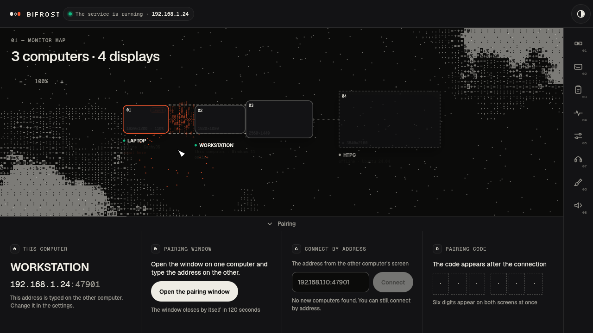
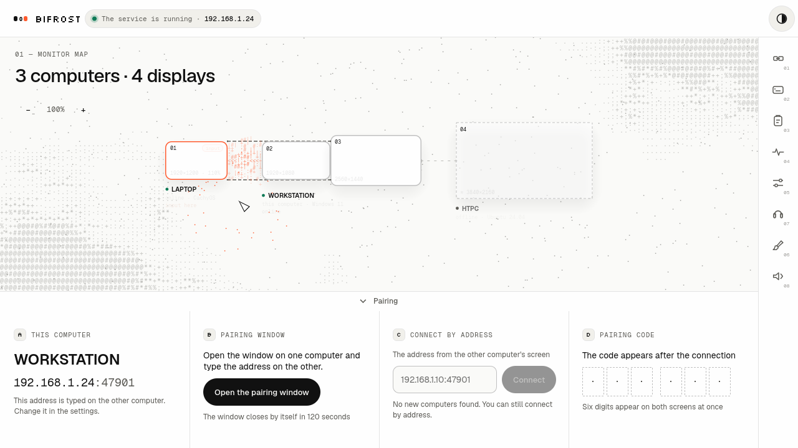

# Bifrost

**A rainbow bridge between your computers.**

Bifrost is a software KVM: share one keyboard, mouse and text clipboard—and, optionally, system audio—across Windows and Linux computers on your LAN. Control connections use mutual TLS, and you pair computers by comparing a six-digit code on both screens. This is my personal project and an early release—not a polished replacement for every hardware KVM.




*Screenshots rendered from the actual UI with example computers; no personal network data.*

## What it does

- Mutual TLS, pairing requests accepted before six-digit confirmation on both computers, and synchronized unpairing.
- LAN discovery with dotted, gently animated cards for unpaired computers (**Connect / Hide**), plus rediscovery of trusted computers after address changes; manual addresses remain available.
- Live RTT p95 and jitter on the status screen, with latency pills on the monitor map.
- A freely arranged monitor map, edge links across gaps and an animated ASCII bridge.
- Edge glow to show where input is going.
- Shared **text** clipboard with history, follow-cursor/broadcast policies and **Send to…**; separately opt-in **PNG images on Windows, X11 and KDE Wayland (data-control)** (images are never kept in history; no files).
- Optional **shared audio**: one headset on a Listener, with system sound from authorized Sources; mix all sources or follow input focus.
- A popup audio mini-player with now-playing information, local per-source volume/mute and separately permitted media buttons; optional system-wide mute/PTT control of the Listener's physical microphone.
- Game mode guards against accidental edge switches in fullscreen apps; manual mode is available on Wayland.
- Configurable switching hotkeys and an emergency release shortcut.
- Russian and English, light and dark themes.
- System tray and a per-user **Start at login** toggle in Settings.
- One executable for the window, core, input agent and optional isolated audio worker—no separate service to install.
- Version badges on the map and coordinated updates of trusted computers, with the requesting computer updated last.

The input lease defaults to `timing.lease_ttl_ms = 1000` (allowed range 300–1000 ms). Challenges run every `min(TTL/5, 100 ms)`, or 100 ms by default. This fixed budget accommodates a 500 ms TCP stall when renewals resume in time; it cannot guarantee survival through unlimited loss. There is no grace period or adaptive extension: core and agent deadlines stay anchored to challenge issuance plus TTL. The control-return bound is TTL + 100 ms scheduling allowance (1100 ms by default); repeat guard (150 ms) and agent core-silence timeout (300 ms) are unchanged.

### Input reliability in 0.4.0

The newest absolute pointer position is kept outside the bounded input queue, rather than dropping it when that queue is full. A button, key or wheel event freezes the preceding position first; discrete events and lease boundaries keep their order. Pending motion is cleared at lease end and cannot carry into another lease.

Reading and coordination run independently of the single TLS writer. Lease/control messages and Pong have bounded frame-level priority. A **pending frame**, not an idle healthy connection, closes the link after 600 ms without write progress or 1000 ms total; a partially written frame is never reused. Shutdown shares a 100 ms budget. These limits do not extend the lease or change its control-return bound.

The receiving core admits at most 64 native input batches and keeps at most 64 more in a local FIFO, advancing on exact local completions matched by lease and sequence. It no longer evicts an outstanding offer and mistakes a successful burst for a partial injection. Lease/deadline controls remain independent of this input backlog; input does not wait for network `InjectAck` credit.

Bounded diagnostics report p50/p95/p99, durations and counters for capture-receipt age, queue waiting, TLS writes, inbound dispatch, local injection and send-to-`InjectAck` round trips—never input coordinates, keys or content. The source's monotonic capture-receipt timestamp is not a hardware HID timestamp; no clocks are synchronized across computers. The RTT shown in the UI remains Ping RTT, not input latency.

Input still shares one reliable TLS/TCP stream: packet loss can cause retransmission and head-of-line stalls. The controlled [two-core Docker benchmark](apps/bifrost/tests/bench_b/README.md) checks delivery, ordering and release safety; its variable loss tails are **not a claim of reduced Wi-Fi p99**.

**Game mode** (Settings) blocks only edge switching: `auto` detects fullscreen apps on Windows/X11 and cursor confinement on Windows; `always` requires an explicit switch, and `off` disables the guard. Per-app allow/block lists match executable basenames or X11 WM_CLASS, case-insensitively; allow takes precedence in auto. **Ctrl+Alt+Shift+G** toggles auto/always (configurable under hotkeys), and the tray offers the same toggle. Explicit switches and emergency release always work, including while input is already remote. Wayland cannot expose foreground apps: use manual mode there. `[game_guard]` defaults to `mode = "auto"`, `block_apps = []`, `allow_apps = []`.

## Download & install

Get **0.4.0** from [Releases](https://github.com/ynnmuraii/bifrost/releases/latest). The release includes `SHA256SUMS.txt` and its detached Ed25519 signature, `SHA256SUMS.txt.sig`.

Versions from **0.1.4** can update from **Settings** or the startup update notice. The app checks for newer stable releases shortly after startup; turn this off in **Settings → Check on startup**, or check manually next to the version. Updates keep a binary backup and ask before restarting all roles; your configuration and pairing are preserved. System-wide, non-writable installations must be updated manually.

**0.1.6 and newer refuse unsigned updates:** the updater verifies the checksum file's Ed25519 signature with its embedded public key before checking the download's SHA-256. For manual OpenSSL verification using a trusted copy of the public key, see [the packaged guide](packaging/README_RU.txt).

**Update all computers** updates online trusted computers first and this computer last. Each target independently fetches the official latest release and verifies its signed checksums; peers cannot supply a download URL or binary. Per-computer progress and refusals stay visible. Disable requests from other computers in **Settings → Allow updates from other computers** (`[update].allow_remote_request = false`). Requests are limited to one per peer every ten minutes. Computers running **0.1.x must each update individually to 0.3.1** before update-all works; 0.1.6 offers this release in Settings or the startup notice.

### Windows 11 · x86_64

Download **`bifrost-0.4.0-windows-x86_64.exe`**, put it somewhere you want to keep it, and run it. No installer or administrator account is needed. The `.zip` contains the same executable plus the Russian guide, third-party notices and example configuration.

The executable has no Authenticode signature. If SmartScreen says “Windows protected your PC”, choose **More info → Run anyway** only if you trust this download. If Windows Firewall asks, allow Bifrost on **private networks only**; allow **TCP 47901/47902 + UDP 47902 (discovery)** (multicast `239.255.47.90`, TTL 1). Opening TCP alone does not enable discovery. Bifrost does **not** automatically add or change Windows Firewall rules.

For shared audio, usually no extra UDP rule is needed on stateful LAN firewalls after the pinned TCP link is established; at least one TCP 47901 direction must be reachable. If audio path validation fails, allow **UDP 47903 from the Source's LAN address on the Listener** (or the configured audio port), scoped to the private network. This does not bypass Windows Firewall, access-point/client isolation or VPN policy.

Settings are created automatically in `%APPDATA%\bifrost`; logs go to `%LOCALAPPDATA%\bifrost`. An existing `lan-workspace` directory from 0.3.x is moved there automatically on the first start (see *Updating* below). To start Bifrost when you sign in, enable **Settings → Start at login**. The login entry runs `gui --login`, which starts the core even with an existing configuration. Opening the window manually does not restart a deliberately stopped core; first-run setup and an update restart still start it. Login entries created by older versions need the toggle turned off and on once to adopt this behavior. The entry uses the executable's current path: if you move the file later, turn the toggle off and on again.

### Linux · x86_64

Download **`bifrost-0.4.0-linux-x86_64.tar.gz`** and extract it:

```sh
tar -xzf bifrost-0.4.0-linux-x86_64.tar.gz
./install.sh
```

No `sudo`: this installs `~/.local/bin/bifrost`, an application-menu entry and icons. Open **Bifrost** from your applications menu, or run `~/.local/bin/bifrost`. To remove the installed application, run `./install.sh --uninstall` from the extracted archive; your `~/.config/bifrost` settings and pairing are never removed.

**Settings → Start at login** creates a per-user autostart entry with `gui --login`, so login starts the core; a manual application-menu launch preserves a stopped core. For an entry created by an older version, turn this setting off and on once.

Runtime: X11 works too; Wayland input sharing needs `xdg-desktop-portal` with RemoteDesktop/InputCapture and a compatible backend (KDE Plasma ≥6.1 or GNOME ≥45). The GitHub Linux build targets **glibc 2.35 or newer** (Ubuntu 22.04 baseline); older distributions should build from source. Allow **TCP 47901/47902 + UDP 47902 (discovery)** on your LAN firewall. UDP 47902 is separate from TCP 47902 clipboard; discovery does not require enabling clipboard. Shared audio usually needs no extra UDP rule on stateful LAN firewalls after the pinned TCP link; TCP 47901 must be reachable in at least one direction. If path validation fails, allow **UDP 47903 from the Source's LAN address on the Listener** (or `audio.media_port`). Bifrost adds no firewall rules; AP/client isolation and VPN policy still apply.

## Quick start

1. Run Bifrost on both computers, on the same trusted LAN. On a fresh setup, the window starts its core and creates the settings automatically.
2. Select a discovered computer and click **Connect**, then **Accept** its pairing request on the other screen. Incoming requests can be disabled in **Settings → Accept pairing requests** (`[pairing] accept_requests = false`). With older versions or a manual address, first open the pairing window on the other computer, then connect as before.
3. Compare the six-digit codes and confirm on **both** computers. Only confirm if the codes match.
   A request grants no trust. Accept opens a temporary window restricted to the requesting certificate; declining mutes that identity for ten minutes.
4. Arrange the screens on the map and connect their edges. Right-click a display-edge pair to allow or forbid crossing it (forbidden edges are dashed); a very short shared span is left off automatically and can be enabled the same way. Take control on the computer whose keyboard you want to use, then move across a linked edge. Enable the shared clipboard if you want it, and test your emergency shortcut first.

Pairing requests and synchronized unpairing require **0.3.1 on both computers**. Unpairing removes trust on the other computer immediately if online, or on its next connection within 30 days. Older versions keep manual pairing windows and may show a manual **Remove** suggestion instead of synchronized removal.

New peers use commitment/reveal SAS; a visible GUI/CLI warning identifies the less-protected legacy pairing ceremony. Always compare the codes on both screens. Clipboard restart detection requires capability 14 on both peers; legacy peers retain same-process reconnect replay protection, but cannot detect a peer process restart.

Existing settings, pairing and the private key move from the old `lan-workspace` directories to `bifrost` automatically on the first 0.4.0 start; no new pairing is needed. Close Bifrost 0.3.x completely before installing 0.4.0. If the old directory is still in use, that start keeps using the old paths and the next start moves them. 0.4.0 cannot connect, pair or share input with 0.3.x, so update every computer; **do not downgrade to 0.3.x** afterwards.

Directory overrides are handled separately: `--state-dir` or `--runtime-dir` does not prevent the default settings and identity directories from migrating. `--root` keeps the whole profile isolated, and arbitrary explicit directory paths remain unchanged. Legacy default paths passed by a 0.3.x updater are translated to the effective migrated paths before the tray, window or core starts.

**Clipboard destinations:** sharing is opt-in; once enabled, `clipboard.policy = "follow"` is the default. Copying keeps text on its origin until the cursor settles on another computer (first key/button press or `clipboard.settle_ms`, default 700 ms, clamped to 200–3000). Passing through a screen does not overwrite its clipboard. History’s **Send to…** sends only to the chosen online trusted computer; sending the current copied item stops it following until the next copy. Sending an older row leaves the current carry intact. Settings can restore `"broadcast"` for copies made on this computer; the source’s policy applies even when the keyboard is on another computer. Secret-marked text is never carried or stored.

For routed input, capable peers acknowledge application before the first press is released (up to 150 ms). Native local input is never held: observed key/button presses or the dwell trigger delivery, and an explicit return to local triggers it immediately. Wayland may not expose local key presses, so an automatic return there uses the dwell. Pasting locally before the transfer completes can still paste the previous clipboard, especially with large text.

**Clipboard images:** supported on Windows, X11 and KDE Wayland with data-control; GNOME Wayland remains unsupported. Enable clipboard sharing and its separate image option on both computers (`clipboard.images`, off by default). Linux passes PNG through unchanged; Windows converts DIB images locally and publishes PNG + DIBV5 on apply. Text wins when an item also contains text, and secret-marked images are refused before image reads. The default PNG limit is 16 MiB (configurable up to 32 MiB), with a separate default rate of 8 MiB/s. Images follow the same destination policy but never enter history. Windows native decode is bounded to 16384 pixels per axis and 128 MiB of RGBA; additional APNG frames are rejected there.

**Discovery and privacy:** discovery and advertising are on by default (`[discovery] enabled = true`, `advertise = true`). Settings lets you turn discovery off; set `advertise = false` in `config.toml` to search without announcing this computer. Names, node IDs, OS metadata, listen ports and pairing availability are visible to other computers on the selected LAN, not encrypted or proof of trust. No secrets, pairing codes, keystrokes or clipboard content are advertised. Pairing still requires matching codes on both computers; changed addresses are used for trusted peers only after pinned mTLS verifies the expected identity, never to replace a live link.

Discovery uses private IPv4 UDP multicast, not mDNS/Avahi/Bonjour. It is limited to selected LAN adapters; VPN adapters are used only when explicitly selected. Wi-Fi multicast filtering, guest/client isolation or separate VLANs may hide computers. **Enter the address manually** if the list is empty; TCP connectivity is still required, so manual entry cannot bypass network isolation.

## Shared audio

One headset on a single **Listener**, system sound from up to three authorized **Sources**. **Mix All** plays them together; **Follow Focus** makes the focused computer primary and quietens the others. Audio is off by default.
The popup mini-player shows now-playing information and media buttons where the player supports them, plus local per-source volume/mute. Each Source separately permits its Listener's media commands; this is off by default.
Optional system-wide mic mute/PTT controls the Listener's physical microphone, affecting all apps using it. Enable it separately on both computers and grant each controlling Source permission on the Listener; microphone control is off by default, and no microphone audio is streamed.

1. Use the same audio-capable build on both computers, pair them, and keep both cores running.
2. On the headset computer, open **Audio settings → Use this computer as the listener**, choose its output, apply, then enable audio.
3. On each Source, select the **Trusted Listener**, apply while sharing is disabled, wait for group confirmation, then enable audio.
4. Allow sending on the Source and receiving on the Listener, apply, then **Start system audio** from the Source.

**Firewall:** usually no extra UDP rule is needed on stateful LAN firewalls after the pinned TCP link; TCP 47901 must be reachable in at least one direction. If path validation fails, allow UDP 47903 from the Source's LAN address on the Listener (or `audio.media_port`). No rules are added automatically; Windows Firewall, AP/client isolation and VPN restrictions are not bypassed.
**Privacy:** pairing alone grants no audio permission. Bilateral consent gates capture and playback; ChaCha20-Poly1305 session keys come from the pinned mutual-TLS link. Now-playing metadata is shared only within active consented sessions; metadata, audio payloads and session keys are never logged or persisted.

| Platform | Audio backend |
| --- | --- |
| Windows 11 | WASAPI process-loopback excludes the audio worker's own process tree; native media/mic/PTT controls where available. |
| Linux | Local PipeWire/PulseAudio monitor capture/playback, without process exclusion; MPRIS media sessions; mic-mute ownership is best-effort. |
| Wayland global PTT | Requires a compatible KDE/GNOME GlobalShortcuts portal with press/release events; unavailable when the portal is missing, including GNOME 46. |
| X11 PTT | No native global PTT; focused GUI PTT remains available without a global hotkey. |

- **Latency:** device buffers affect delay; Wi-Fi uses more buffering and Bluetooth can add substantial latency. Prefer a wired LAN when delay matters.
- **No microphone streaming or virtual microphone yet:** a Listener's headset mic does not appear on a Source; dependent microphone-target routing/UX is also deferred.
- **No macOS or AEC:** headphones are recommended to avoid acoustic feedback. See the [commented configuration example](crates/config/examples-data/config.example.toml) for defaults and downgrade precautions.

## Platform support

| Platform | Input sharing | Shared audio |
| --- | --- | --- |
| Windows 11 | Capture and receive input | WASAPI system audio; process-tree exclusion and native media/mic/PTT controls where available |
| Linux X11 | Capture and receive input | Pulse-compatible monitor audio/MPRIS; focused GUI PTT, not native global X11 PTT |
| KDE Plasma ≥6.1 · Wayland | Through desktop portals; permissions required | Pulse-compatible audio/MPRIS; global PTT requires a compatible GlobalShortcuts portal |
| GNOME ≥45 · Wayland | Portal capabilities vary; GNOME 46 can receive but cannot capture input for another computer | Pulse-compatible audio/MPRIS; global PTT only where the portal exists, not GNOME 46 |
| wlroots-based Wayland desktops | Not supported | Not a supported Bifrost desktop |
| macOS | Not supported | Not supported |

## Known limitations

- Early software: keep access to a local keyboard and test emergency release before relying on remote input.
- The Windows executable has no Authenticode signature and may trigger SmartScreen; release checksums have a separate Ed25519 signature. Linux desktops may need explicit portal approval.
- Wayland shows a desktop-portal permission dialog on first use. Support depends on your compositor and portal backend.
- The emergency hotkey on Wayland depends on the **GlobalShortcuts portal**. On KDE, launch Bifrost from its desktop entry or an `app-bifrost@….service` unit so the portal can identify it. GNOME 46 has no GlobalShortcuts portal. Check the emergency-hotkey status in **Keys**; do not assume the shortcut works just because the app is running.
- Clipboard sharing is off by default; PNG images require a second opt-in. Windows, X11 and KDE Wayland (data-control) support images; GNOME Wayland does not.
- Shared audio is off by default and requires explicit permissions on both computers; pairing does not grant audio consent. A Source selects one Listener.
- Linux monitor capture cannot exclude individual applications. Microphone streaming, virtual-microphone routing and dependent target UX are deferred; native global X11 PTT is unsupported.
- Endpoint mute affects every app using that microphone. Linux mute restoration has best-effort ownership, not an atomic guarantee against other mute writers; Linux global PTT needs a compatible Wayland portal with both press and release events.
- Audio includes driver/device buffering and is not a hard-realtime or studio-monitoring link. Wi-Fi and Bluetooth can add delay; there is no AEC, so headphones are recommended.

## Windows command line

Run CLI commands from cmd/PowerShell (also inside Windows Terminal), or use `cmd /c` in hosts that launch the windowed executable directly; without a console or redirected output, Bifrost exits with code 69 and records the launch hint in the configured core log.

## Build from source

Use [Rust via rustup](https://rustup.rs/) with the repository's toolchain (Rust 1.99 or newer). Windows needs the MSVC C++ build tools and Windows SDK.

The default-enabled `audio` feature builds bundled, statically linked libopus and needs CMake
on the build host (not on the machine running Bifrost). On Windows, a non-admin installation
with Python is `python -m pip install --user cmake`; this was exercised with CMake **4.4.4**.
For the current shell only, add Python's user scripts directory (reported by
`python -m site --user-base`, followed by `Python311/Scripts` for Python 3.11 on Windows)
to `PATH`; do not change the system-wide environment. Alternatively set `CMAKE` to the
absolute path of that installation's `cmake.exe`. A build without audio uses
`cargo build --release -p bifrost --no-default-features`.

On Ubuntu/Debian, install CMake alongside the other build/test prerequisites:

```sh
sudo apt-get update
sudo apt-get install --yes --no-install-recommends build-essential cmake binutils xvfb xauth
cargo build --release -p bifrost
```

The executable is `target/release/bifrost` (`bifrost.exe` on Windows). `xvfb` and `xauth` are for headless tests, not for building or running the desktop app. X11/Wayland libraries are loaded at runtime; the Rust build does not require their development headers.

```sh
cargo build --workspace
cargo fmt --all --check
cargo clippy --workspace --all-targets -- -D warnings
cargo test --workspace
```

Do **not** run ignored tests on your everyday desktop: some intentionally drive real input. Linux CI runs tests under `xvfb-run -a -s "-screen 0 1280x1024x24 -noreset"`.

For an explicitly audible Windows audio smoke, run
`cargo run -p bifrost-audio --example windows_e2e -- --audible`.
It plays a six-second 1 kHz tone on the default multimedia output, opens two native audio
workers and ephemeral localhost UDP sockets, and captures render loopback in memory.
It never changes endpoint routing, volume or mute. A 500 ms test-only ciphertext delay
separates the listener's remaining output from the helper's direct tone; reported latency
includes that delay, and the delay-subtracted value is only an estimate. Muted or
loopback-suppressed endpoints can fail the signal assertions; do not change real endpoint
settings just to obtain a pass.
The example reports the Listener's worker Health drift-controller ratio, fill error and
coarse corrections beside its independent delivered-sample/QPC capture estimate. These
measure different quantities; Source has no receiver drift controller.

For a Windows timing-only diagnostic, run
`cargo run -p platform-audio-win --example hw_probe -- --timing`.
It initializes—but never starts—capture/render clients and prints actual buffer capacities,
engine periods and available native latency queries. It plays no tone and changes no
endpoint settings; process-loopback period/latency queries may report unsupported.

For long-run Windows audio measurements, add `--seconds 60` to `windows_e2e --audible`.
The helper streams into a bounded ring; the probe retains only onset/tail PCM and reports
steady-state underruns after two seconds of tone warmup.

Windows render attempts `IAudioClient3` shared/event mode with the smallest supported
fundamental-multiple period at or above **5 ms**. The floor keeps a two-period queue
at roughly 10 ms rather than relying on a minimum-period scheduling deadline. The
adapter queues at most **two periods**, capped by the actual WASAPI buffer capacity.
Process-loopback capture retains its existing EXCLUDE behavior and format.
Unsupported exact formats, unavailable interfaces/periods and an engine period locked
by another application fall back to the legacy shared-mode/conversion path. Native
stream snapshots report the selected mode, period, capacity, queue limit and typed
fallback reason/HRESULT. Legacy clients query the current shared engine period rather
than assuming the default; when that query is unsupported, the snapshot explicitly
labels the default-period estimate. Shared engine periods are endpoint-wide and can
affect other applications; no endpoint routing, volume or mute setting is changed.

`hw_probe --timing --period min|5ms|10ms` reports negotiated versus legacy timing without
starting streams. For explicit audible candidate stress, use
`cargo run -p platform-audio-win --example hw_probe -- --stress-period 5ms --seconds 60`.
It uses a bounded tone ring and reports post-warmup source exhaustion separately from
zero-padding observations and the two-period engine-starvation heuristic. The heuristic
is not a driver xrun counter; on a buffer smaller than two periods, zero padding alone
does not establish starvation.

For isolated native media-control acceptance, run
`cargo run -p bifrost-audio --example windows_media_e2e -- --owned-test`.
It creates its own short-lived SMTC player with a generated tone and unique identity,
authorizes a native Source over private IPC, and sends encrypted audio only to a local
Dry discard listener. Metadata must remain absent before consent; play/pause/next are
addressed only to that helper's exact token/revision. An ambiguous or non-owned current
session fails closed rather than controlling another application. Owned processes are
reaped and samples remain in memory. No microphone mute or synthesized input is used.

Child mic/PTT tests use Dry mute targets for grants, expiry and persistent toggles.
Windows registration-only tests temporarily reserve Ctrl+Alt+Shift+F23/F24 and release
them; they never press keys or mutate a real capture endpoint.

## License

[MIT](LICENSE). Distributed third-party components are listed in [THIRD_PARTY_NOTICES.md](licenses/THIRD_PARTY_NOTICES.md).

Bifrost was formerly called MultiDeskFlow; the repository URL has not changed.
