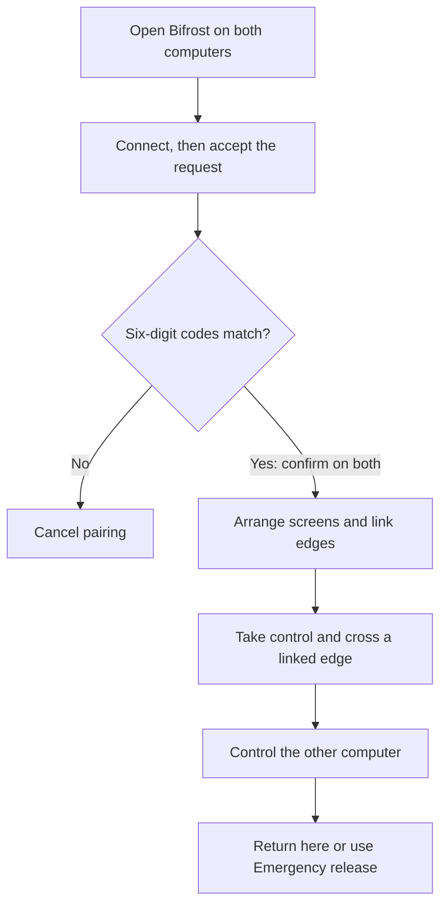
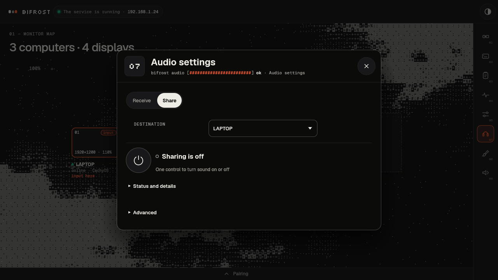
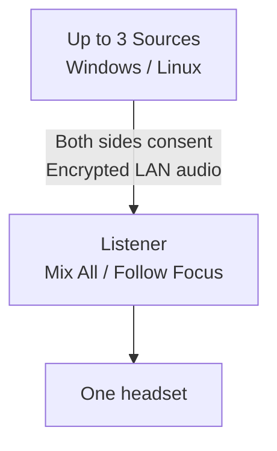

# Bifrost

**One keyboard and mouse for your Windows and Linux computers, a shared clipboard, and optional system audio in one headset.**

Keep your computers separate. Move between their screens over your LAN without changing the keyboard under your hands.

**[Download Bifrost 0.5.1](https://github.com/ynnmuraii/bifrost/releases/latest)** · [Get started](#get-started) · [Platform support](#platform-support) · [Русская инструкция](packaging/README_RU.txt)

<picture>
  <source media="(prefers-color-scheme: dark)" srcset="assets/readme/main-dark.png">
  <source media="(prefers-color-scheme: light)" srcset="assets/readme/main-light.png">
  
</picture>

*The actual Bifrost 0.5.0 interface, rendered offscreen with example computers. The map illustrates a setup, not a live network.*

## Make room on your desk

- **Desktop and laptop, one set of controls.** Arrange their displays on the map, link the edges, and move across with your mouse. Use a switching hotkey when you prefer.
- **Copy here, paste there.** Opt into text clipboard sharing that follows the computer you use, or send a history item to a chosen trusted computer. PNG images have a separate opt-in on supported desktops; files are not transferred.
- **Keep the headset plugged in.** Opt into system audio from up to three authorized computers on one Listener. Mix them together or let input focus decide which is louder.

Bifrost is a personal project and an early release, not a replacement for every hardware KVM. Windows 11 and Linux X11 are supported; Wayland depends on your desktop and its portals. There is no macOS support or microphone streaming.

The app has English and Russian interfaces, light and dark themes, a system tray and optional start at login. One executable includes the window, core, input agent and isolated audio worker; no separate service to install.

## Get started

1. [Install Bifrost](#download--install) on both computers and open it on the same trusted LAN.
2. Select a discovered computer and choose **Connect**. **Accept** the request on the other screen, then compare the six-digit codes and confirm on **both** computers only if they match.
3. Arrange the screens on the map and connect their edges. Take control from the computer whose keyboard you want to use, then move across a linked edge.
4. Test **Emergency release** before relying on remote input. Enable clipboard sharing if you want it; system audio remains off until you set it up separately.

<details>
<summary>How pairing works</summary>



</details>

If discovery is empty, enter the address manually; this cannot bypass firewall or network isolation. Keep a local keyboard available, especially while setting up Wayland permissions.

Outgoing capture is refused while physical keys/buttons are held or their state is unknown. Release the switching chord before switching; a pending Switch Next intent expires after 400 ms. After agent failure, routing stays blocked until synthetic-input recovery receives an exact successful release acknowledgement. Native release errors are not reported as successful cleanup.

## Download & install

**[Get the 0.5.1 release](https://github.com/ynnmuraii/bifrost/releases/latest)** for both computers. Choose the same version on each.

- **Windows 11 · x86_64:** download `bifrost-0.5.1-windows-x86_64.exe`, keep it in a permanent folder, and run it. No administrator account or installer is needed. The executable is not Authenticode-signed; check the download before bypassing SmartScreen.
- **Linux · x86_64:** extract `bifrost-0.5.1-linux-x86_64.tar.gz`, run `./install.sh` without `sudo`, then open Bifrost from the applications menu. The release requires glibc 2.35 or newer.

On a firewall prompt, allow **private networks only**. Bifrost does not add firewall rules. [Installation, firewall and upgrade details](#technical-details) include ports, signed-checksum verification and older-version migration.

## Shared audio

Use the headset already connected to your **Listener** to hear your other computers. On the Listener, enable receiving; on each **Source**, select that trusted Listener and enable sharing. Pairing alone never grants audio permission.



<details>
<summary>See the audio mini-player</summary>


</details>

*Audio views rendered from the actual 0.5.0 interface with example computers, invented media metadata and synthetic cover art; no live audio session.*



Audio is off by default. Media buttons and physical microphone mute/PTT each need separate permission; **microphone audio is never streamed**. Device buffers, Wi-Fi and Bluetooth can add delay. Use headphones: there is no acoustic echo cancellation.

## Trust comes first

Pair by comparing the six-digit code on **both screens**. Control connections use pinned mutual TLS; a discovery card is not proof of identity or permission to connect.

Clipboard and audio sharing are opt-in. Text clipboard items are capped at 1 MiB; PNG images need a second opt-in, default to a 16 MiB limit (up to 32 MiB), and never enter history. Pairing does not grant audio, media-control or microphone-control permission.

Use a trusted LAN. Discovery announces computer names and connection metadata to that LAN without encryption; it never advertises pairing codes, keystrokes or clipboard content. You can disable discovery or use manual addresses.

Closing the window does not stop the core or an active session. Use the app's explicit controls to return input or stop sharing.

## Platform support

| Platform | Input sharing | Shared audio |
| --- | --- | --- |
| Windows 11 | Capture and receive input | WASAPI system audio; process-tree exclusion and native media/mic/PTT controls where available |
| Linux X11 | Capture and receive input | Pulse-compatible monitor audio/MPRIS; focused GUI PTT, not native global X11 PTT |
| KDE Plasma ≥6.1 · Wayland | Portal receiving; outgoing switching unavailable while physical state is unknown | Pulse-compatible audio/MPRIS; current zero portal timestamps cannot prove native PTT freshness; GUI hold-to-talk remains available |
| GNOME ≥45 · Wayland | Receive where RemoteDesktop is available; outgoing switching unavailable while physical state is unknown | Pulse-compatible audio/MPRIS; native PTT requires a present portal with verifiable fresh timestamps, not GNOME 46 |
| wlroots-based Wayland desktops | Not supported | Not a supported Bifrost desktop |
| macOS | Not supported | Not supported |


## Before you rely on it

- Keep a local keyboard available and test Emergency release. On Wayland, check the shortcut status in **Keys**: a running app does not mean the portal supports that shortcut.
- GNOME Wayland cannot share PNG clipboard images; GNOME 46 can receive input but cannot capture it for another computer. wlroots desktops and macOS are unsupported.
- This is not a hard-realtime audio link. Linux monitor capture cannot exclude individual apps; microphone mute affects every app using that physical microphone.

## Technical details

<details>
<summary>Platform limitations and emergency-key precautions</summary>

## Known limitations

- Early software: keep access to a local keyboard and test emergency release before relying on remote input.
- The Windows executable has no Authenticode signature and may trigger SmartScreen; release checksums have a separate Ed25519 signature. Linux desktops may need explicit portal approval.
- Wayland shows a desktop-portal permission dialog on first use. Receiving depends on your compositor and portal backend; outgoing keyboard/mouse switching fails closed while physical held state cannot be established. Receiving and independent audio remain available where supported.
- The emergency hotkey on Wayland depends on the **GlobalShortcuts portal**. On KDE, launch Bifrost from its desktop entry or an `app-bifrost@….service` unit so the portal can identify it. GNOME 46 has no GlobalShortcuts portal. Check the emergency-hotkey status in **Keys**; do not assume the shortcut works just because the app is running.
- Clipboard sharing is off by default; PNG images require a second opt-in. Windows, X11 and KDE Wayland (data-control) support images; GNOME Wayland does not.
- Shared audio is off by default and requires explicit permissions on both computers; pairing does not grant audio consent. A Source selects one Listener.
- Linux monitor capture cannot exclude individual applications. Native portal PTT fails closed on unverifiable clocks or conservative event age over 250 ms, including delayed first events; use GUI hold-to-talk. Microphone streaming, virtual-microphone routing and dependent target UX are deferred; native global X11 PTT is unsupported.
- Endpoint mute affects every app using that microphone. Linux mute restoration has best-effort ownership, not an atomic guarantee against other mute writers; native portal PTT additionally requires the verifiable clocks described above.
- Audio includes driver/device buffering and is not a hard-realtime or studio-monitoring link. Wi-Fi and Bluetooth can add delay; there is no AEC, so headphones are recommended.

</details>

<details>
<summary>Installation, firewall, upgrades, pairing and clipboard</summary>

### Installation & upgrades

## Download & install

Get **0.5.1** from [Releases](https://github.com/ynnmuraii/bifrost/releases/latest). The release includes `SHA256SUMS.txt` and its detached Ed25519 signature, `SHA256SUMS.txt.sig`.

Versions from **0.1.4** can update from **Settings** or the startup update notice. The app checks for newer stable releases shortly after startup; turn this off in **Settings → Check on startup**, or check manually next to the version. Updates keep a binary backup and ask before restarting all roles; your configuration and pairing are preserved. System-wide, non-writable installations must be updated manually.

**0.1.6 and newer refuse unsigned updates:** the updater verifies the checksum file's Ed25519 signature with its embedded public key before checking the download's SHA-256. For manual OpenSSL verification using a trusted copy of the public key, see [the packaged guide](packaging/README_RU.txt).

**Update all computers** updates online trusted computers first and this computer last. Each target independently fetches the official latest release and verifies its signed checksums; peers cannot supply a download URL or binary. Per-computer progress and refusals stay visible. Disable requests from other computers in **Settings → Allow updates from other computers** (`[update].allow_remote_request = false`). Requests are limited to one per peer every ten minutes. Computers running **0.1.x must each update individually to 0.3.1** before update-all works; 0.1.6 offers this release in Settings or the startup notice.

### Windows 11 · x86_64

Download **`bifrost-0.5.1-windows-x86_64.exe`**, put it somewhere you want to keep it, and run it. No installer or administrator account is needed. The `.zip` contains the same executable plus the Russian guide, third-party notices and example configuration.

The executable has no Authenticode signature. If SmartScreen says “Windows protected your PC”, choose **More info → Run anyway** only if you trust this download. If Windows Firewall asks, allow Bifrost on **private networks only**; allow **TCP 47901/47902 + UDP 47902 (discovery)** (multicast `239.255.47.90`, TTL 1). Opening TCP alone does not enable discovery. Bifrost does **not** automatically add or change Windows Firewall rules.

For shared audio, usually no extra UDP rule is needed on stateful LAN firewalls after the pinned TCP link is established; at least one TCP 47901 direction must be reachable. If audio path validation fails, allow **UDP 47903 from the Source's LAN address on the Listener** (or the configured audio port), scoped to the private network. This does not bypass Windows Firewall, access-point/client isolation or VPN policy.

Settings are created automatically in `%APPDATA%\bifrost`; logs go to `%LOCALAPPDATA%\bifrost`. An existing `lan-workspace` directory from 0.3.x is moved there automatically on the first start (see *Updating* below). To start Bifrost when you sign in, enable **Settings → Start at login**. The login entry runs `gui --login`, which starts the core even with an existing configuration. Opening the window manually does not restart a deliberately stopped core; first-run setup and an update restart still start it. Login entries created by older versions need the toggle turned off and on once to adopt this behavior. The entry uses the executable's current path: if you move the file later, turn the toggle off and on again.

### Linux · x86_64

Download **`bifrost-0.5.1-linux-x86_64.tar.gz`** and extract it:

```sh
tar -xzf bifrost-0.5.1-linux-x86_64.tar.gz
./install.sh
```

No `sudo`: this installs `~/.local/bin/bifrost`, an application-menu entry and icons. Open **Bifrost** from your applications menu, or run `~/.local/bin/bifrost`. To remove the installed application, run `./install.sh --uninstall` from the extracted archive; your `~/.config/bifrost` settings and pairing are never removed.

**Settings → Start at login** creates a per-user autostart entry with `gui --login`, so login starts the core; a manual application-menu launch preserves a stopped core. For an entry created by an older version, turn this setting off and on once.

Runtime: X11 works too; Wayland input sharing needs `xdg-desktop-portal` with RemoteDesktop/InputCapture and a compatible backend (KDE Plasma ≥6.1 or GNOME ≥45). The GitHub Linux build targets **glibc 2.35 or newer** (Ubuntu 22.04 baseline); older distributions should build from source. Allow **TCP 47901/47902 + UDP 47902 (discovery)** on your LAN firewall. UDP 47902 is separate from TCP 47902 clipboard; discovery does not require enabling clipboard. Shared audio usually needs no extra UDP rule on stateful LAN firewalls after the pinned TCP link; TCP 47901 must be reachable in at least one direction. If path validation fails, allow **UDP 47903 from the Source's LAN address on the Listener** (or `audio.media_port`). Bifrost adds no firewall rules; AP/client isolation and VPN policy still apply.

## Pairing & clipboard

1. Run Bifrost on both computers, on the same trusted LAN. On a fresh setup, the window starts its core and creates the settings automatically.
2. Select a discovered computer and click **Connect**, then **Accept** its pairing request on the other screen. Incoming requests can be disabled in **Settings → Accept pairing requests** (`[pairing] accept_requests = false`). With older versions or a manual address, first open the pairing window on the other computer, then connect as before.
3. Compare the six-digit codes and confirm on **both** computers. Only confirm if the codes match.
   A request grants no trust. Accept opens a temporary window restricted to the requesting certificate; declining mutes that identity for ten minutes.
4. Arrange the screens on the map and connect their edges. Right-click a display-edge pair to allow or forbid crossing it (forbidden edges are dashed); a very short shared span is left off automatically and can be enabled the same way. Take control on the computer whose keyboard you want to use, then move across a linked edge. Enable the shared clipboard if you want it, and test your emergency shortcut first.

<details>
<summary>Pairing, clipboard destinations, image limits and discovery privacy</summary>

Pairing requests and synchronized unpairing require **0.3.1 on both computers**. Unpairing removes trust on the other computer immediately if online, or on its next connection within 30 days. Older versions keep manual pairing windows and may show a manual **Remove** suggestion instead of synchronized removal.

**Close** or Escape closes the local pairing window and cancels ceremonies admitted through it, preserving unrelated outgoing attempts. In compact windows, scroll the pairing panel to reach all controls. A bind/loopback address is not a destination for another computer: select a LAN address in Settings; IPv6 destinations include brackets. **Rename** requests the existing settings editor and shows `[node].display_name` / service-restart instructions in the panel. Dialog navigation skips the backdrop, reveals focused controls and returns visible focus to the invoking navigation control.

Unadmitted runtime links are closed rather than left waiting. Clipboard dials and unused grants are bounded, deduplicated and invalidated with their authenticated parent connection. History shares immutable text storage without changing content or destination policy. Ownership persistence uses a coalescing background writer rather than blocking input decisions; orderly shutdown drains it, but crash persistence is best-effort.

New peers use commitment/reveal SAS; a visible GUI/CLI warning identifies the less-protected legacy pairing ceremony. Always compare the codes on both screens. Clipboard restart detection requires capability 14 on both peers; legacy peers retain same-process reconnect replay protection, but cannot detect a peer process restart.

Existing settings, pairing and the private key move from the old `lan-workspace` directories to `bifrost` automatically on the first 0.4.0 start; no new pairing is needed. Close Bifrost 0.3.x completely before installing 0.4.0. If the old directory is still in use, that start keeps using the old paths and the next start moves them. 0.4.0 cannot connect, pair or share input with 0.3.x, so update every computer; **do not downgrade to 0.3.x** afterwards.

Directory overrides are handled separately: `--state-dir` or `--runtime-dir` does not prevent the default settings and identity directories from migrating. `--root` keeps the whole profile isolated, and arbitrary explicit directory paths remain unchanged. Legacy default paths passed by a 0.3.x updater are translated to the effective migrated paths before the tray, window or core starts.

**Clipboard destinations:** sharing is opt-in; once enabled, `clipboard.policy = "follow"` is the default. Copying keeps text on its origin until the cursor settles on another computer (first key/button press or `clipboard.settle_ms`, default 700 ms, clamped to 200–3000). Passing through a screen does not overwrite its clipboard. History’s **Send to…** sends only to the chosen online trusted computer; sending the current copied item stops it following until the next copy. Sending an older row leaves the current carry intact. Settings can restore `"broadcast"` for copies made on this computer; the source’s policy applies even when the keyboard is on another computer. Secret-marked text is never carried or stored.

For routed input, capable peers acknowledge application before the first press is released (up to 150 ms). Native local input is never held: observed key/button presses or the dwell trigger delivery, and an explicit return to local triggers it immediately. Wayland may not expose local key presses, so an automatic return there uses the dwell. Pasting locally before the transfer completes can still paste the previous clipboard, especially with large text.

**Clipboard images:** supported on Windows, X11 and KDE Wayland with data-control; GNOME Wayland remains unsupported. Enable clipboard sharing and its separate image option on both computers (`clipboard.images`, off by default). Linux passes PNG through unchanged; Windows converts DIB images locally and publishes PNG + DIBV5 on apply. Text wins when an item also contains text, and secret-marked images are refused before image reads. The default PNG limit is 16 MiB (configurable up to 32 MiB), with a separate default rate of 8 MiB/s. Images follow the same destination policy but never enter history. Windows native decode is bounded to 16384 pixels per axis and 128 MiB of RGBA; additional APNG frames are rejected there.

**Discovery and privacy:** discovery and advertising are on by default (`[discovery] enabled = true`, `advertise = true`). Settings lets you turn discovery off; set `advertise = false` in `config.toml` to search without announcing this computer. Names, node IDs, OS metadata, listen ports and pairing availability are visible to other computers on the selected LAN, not encrypted or proof of trust. No secrets, pairing codes, keystrokes or clipboard content are advertised. Pairing still requires matching codes on both computers; changed addresses are used for trusted peers only after pinned mTLS verifies the expected identity, never to replace a live link.

Discovery uses private IPv4 UDP multicast, not mDNS/Avahi/Bonjour. It is limited to selected LAN adapters; VPN adapters are used only when explicitly selected. Wi-Fi multicast filtering, guest/client isolation or separate VLANs may hide computers. **Enter the address manually** if the list is empty; TCP connectivity is still required, so manual entry cannot bypass network isolation.

</details>

</details>

<details>
<summary>Audio setup, player controls, permissions, local silence and compatibility</summary>

One headset on a single **Listener**, system sound from up to three authorized **Sources**. **Mix All** plays them together; **Follow Focus** makes the focused computer primary and quietens the others. Audio is off by default.
The independent, always-on-top mini-player shows now-playing information where the Source's player supports it, plus local per-source volume/mute. It opens automatically after an observed running stream; an empty player has no playback controls. Each Source separately permits its Listener's media commands; sharing system audio does not enable them.
The volume slider and percentage stay visible inside each card. Drag a card's header to move the player. The **− Hide player** action hides only the window; open it again from the tray's **Audio player** entry. A card's **× Stop audio stream** is separate and stops that stream. **Expand/Collapse** switches between compact and expanded layouts; drag a corner to resize, with each layout's size remembered separately.
Rapid volume changes retain the latest desired value while one request is pending; requested and confirmed levels remain distinct until reconciliation. Player actions preserve dirty **Advanced** edits. Closing Advanced retains the draft; **Discard** restores authoritative settings.
The player header has one receiver-wide mixing-mode button: the cursor icon means **Follow Focus** (the computer you control is louder and background Sources are quieter); the merging-lines icon means **Mix All** (no focus-based attenuation). Hover it for the current mode and the next action. It changes only the connected Listener's current mixing policy, without applying unsaved Advanced edits or restarting streams; while a request is pending or settings are unavailable it cannot change the mode. The icon changes after the core publishes the new setting.
In compact windows the cover and metadata share the upper row, while the timeline, playback and volume controls use the full visible width. Wide and tall windows keep their existing artwork layouts.
Click the track timeline to seek when the Source reports a seekable media session and valid time range; with the timeline focused, Left/Right seeks by five seconds. Unsupported sessions remain read-only, and live system audio is not a rewind buffer. **Pause** controls the Source's player without stopping the shared stream; **Play** remains available while the Source reports that same live media session. Removed or unavailable sessions are not kept as cached controls.
Optional system-wide mic mute/PTT controls the Listener's physical microphone, affecting all apps using it. Enable it separately on both computers and grant each controlling Source permission on the Listener; microphone control is off by default, and no microphone audio is streamed. Windows native PTT starts unarmed: press and release the configured PTT key once, then press again to talk; GUI hold-to-talk does not require native arming.
**Release all PTT** is an emergency release of every GUI/hotkey talk grant on that Listener. Held hotkeys must be released before pressing again. In PTT mode this returns to muted idle; an independently, explicitly unmuted microphone stays unmuted—use **Mute microphone** to close it.

1. Use the same audio-capable build on both computers, pair them, and keep both cores running.
2. On the headset computer, open **Audio settings**, choose **Receive**, and turn audio on.
3. On each Source, choose **Share**, select the trusted headset computer under **Destination**, and turn audio on. This saves the sharing intent and starts connecting; the group is automatic.

Audio settings use one circular power control with an adjacent enabled/off heading. An enabled heading describes requested consent, not proof of native playback; the detail below reports waiting, running or failure. Only **Share** asks for a destination; **Receive** does not. While a route is active, the Receive/Share choice stays locked—turn audio off before changing it. Technical diagnostics live under **Details** and **Advanced**.

No separate **Apply**, **Start**, manual group ID or per-computer system-audio grant is needed for this path. The default configuration selects system devices; change devices, mixing, profiles or explicit per-computer denies in **Advanced** when needed. An explicit deny takes priority over shared consent. Microphone/PTT and media-control permissions remain separate and are not enabled by turning system audio on.

Turning sharing or receiving **off** cancels a pending start and withdraws system-audio consent without changing microphone/PTT or media-control settings. **Stop system audio** has the same system-only scope; a mini-player card's stop action stops just that stream.

**Connecting** or an accepted setting is not proof that sound is flowing. Status distinguishes the request from an observed running stream and shows startup failures with guidance in the audio panel. With **Resume system audio after reconnect** off (`audio.resume_system_audio = false`), restarting a Source leaves sharing stopped even if its saved consent is still on; choose **Share** and turn audio on again to start it. Enabling sharing does not silently change the resume preference.

**Local silence on Linux Sources:** on PipeWire, an authorized active Source mutes only the selected render output whose monitor it captures; opening settings, probing devices or waiting to connect does not mute it. Capture continues while that output is muted. Admission requires actual native `monitor.channel-volumes=false` policy and proof that the Pulse endpoint and PipeWire policy belong to the same server instance. Missing, conflicting or unsupported evidence refuses Source start. A PulseAudio-only Source cannot use this path. Restoration requires a successfully acknowledged Bifrost mute write and retained ownership; controlled tests do not qualify arbitrary hardware or PipeWire versions.

**Local silence on Windows Sources:** Bifrost pins all render outputs active when sharing starts, including virtual outputs. It mutes other apps on those outputs without changing volume. Parallel Source streams share the hold: stopping one cannot unmute another admitted stream. A new, disconnected or replaced output stops sharing rather than automatically retargeting it. Stop, Return here and Emergency restore only the original mute state still owned by Bifrost, best-effort; already-muted outputs stay muted, and crash restoration is not guaranteed. Physical-device qualification of this Windows path is still pending.

Normal stop restores the previous output mute state **best-effort**: an already-muted output stays muted. Volume changes do not release automatic silence: Bifrost reasserts mute without changing the chosen volume. Explicitly **Return here** (default **Ctrl+Alt+Shift+Left**) or use **Emergency** (**Ctrl+Alt+Shift+F12**) on the Source to release automatic silence without stopping capture or transmission, even when input is already local. The local GUI/tray return action and `switch --to local` do the same. This restores the pre-sharing mute state, not a forced unmute: an initially user-muted output stays muted. Repeated returns are harmless; silence stays released until sharing is turned OFF and ON again. Edge crossings, lease expiry and remote return requests do not release it. Device/identity uncertainty forfeits restoration rather than writing to a different output. Restoration after a worker/core crash is not guaranteed. This is independent of microphone/PTT. Windows Listeners keep their existing playback behavior.

**Firewall:** TCP 47901 must be reachable in at least one direction. Audio uses the configured UDP media port (default 47903); allow it between trusted LAN peers if path validation fails. Some stateful LAN firewalls need no extra rule, but this is not guaranteed. Bifrost adds no rules and does not bypass Windows Firewall, VPN or AP/client isolation.
**Privacy:** pairing alone grants no audio permission. Bilateral consent gates capture and playback; ChaCha20-Poly1305 session keys come from the pinned mutual-TLS link. Now-playing metadata is shared only within active consented sessions; metadata, audio payloads and session keys are never logged or persisted.
**Long-running sessions:** capable peers renew media keys over the pinned control connection before the hard 30-minute/per-key packet limit. Capture, playback, Source-local silence/volume and the media-session token stay in place; no new pairing, consent prompt or sharing toggle is needed. OFF, revoked trust and worker/connection failure still stop the session. A failed renewal reports a key-renewal error, not a guessed UDP/firewall failure. Peers without rekey support stop safely at the old key deadline rather than extending it.

Logical stop is not native retirement: replacement starts and Advanced backend cutovers wait for matching cleanup or actual worker loss. Session-local native errors remain visible without crashing an unrelated microphone owner. Linux stop waits for callback storage to retire even on native deletion error; a stuck native reactor can delay teardown.

**Track/video covers:** where the Source exposes one, the mini-player can show a real Windows SMTC thumbnail or a regular local PNG/JPEG in the Linux Source's user cache advertised by MPRIS. Unsupported, absent and remote HTTP(S) locations produce no cover; the Listener never fetches a peer-supplied URL. Images are decoded off the audio/UI real-time paths, reduced to at most 192×192 pixels/48 KiB JPEG and kept only in memory for the active consented session. A valid repeat request can resend a completed image without restarting a partial transfer. Changing the track/session or withdrawing consent discards stale artwork; framing limits are unchanged.

Linux artwork opens relative to held directory descriptors without following symlinks; unsafe paths and stale track generations are rejected. Windows metadata changes invalidate cached covers. Windows local IPC rejects pipe servers whose process user differs or cannot be verified before exchanging application data.

**Compatibility:** audio needs capable builds on both computers; 0.4.0 peers still share input and clipboard. Rekey and artwork are separately capability-gated without changing protocol 1/0. Older binaries reject `[audio]`: restore the earlier `.pre-audio` backup where created, or remove audio tables before downgrading.

| Platform | Audio backend |
| --- | --- |
| Windows 11 | WASAPI process-loopback excludes the audio worker's own process tree; native media/mic/PTT controls where available. |
| Linux | Local PipeWire/PulseAudio monitor capture/playback, without process exclusion; MPRIS media sessions; mic-mute ownership is best-effort. |
| Wayland global PTT | Requires trusted elapsed-ms portal clocks and events no older than 250 ms; current KDE zero timestamps and incompatible Hyprland clocks are unavailable. Use GUI hold-to-talk. |
| X11 PTT | No native global PTT; focused GUI PTT remains available without a global hotkey. |

- **Latency:** device buffers affect delay; Wi-Fi uses more buffering and Bluetooth can add substantial latency. Prefer a wired LAN when delay matters.
- **No microphone streaming or virtual microphone yet:** a Listener's headset mic does not appear on a Source; dependent microphone-target routing/UX is also deferred.
- **No macOS or AEC:** headphones are recommended to avoid acoustic feedback. See the [commented configuration example](crates/config/examples-data/config.example.toml) for defaults and downgrade precautions.

</details>
<details>
<summary>Input reliability, diagnostics and game mode</summary>

The input lease defaults to `timing.lease_ttl_ms = 1000` (allowed range 300–1000 ms). Challenges run every `min(TTL/5, 100 ms)`, or 100 ms by default. This fixed budget accommodates a 500 ms TCP stall when renewals resume in time; it cannot guarantee survival through unlimited loss. There is no grace period or adaptive extension: core and agent deadlines stay anchored to challenge issuance plus TTL. The control-return bound is TTL + 100 ms scheduling allowance (1100 ms by default); repeat guard (150 ms) and agent core-silence timeout (300 ms) are unchanged.

### Input reliability in 0.4.0

The newest absolute pointer position is kept outside the bounded input queue, rather than dropping it when that queue is full. A button, key or wheel event freezes the preceding position first; discrete events and lease boundaries keep their order. Pending motion is cleared at lease end and cannot carry into another lease.

Reading and coordination run independently of the single TLS writer. Lease/control messages and Pong have bounded frame-level priority. A **pending frame**, not an idle healthy connection, closes the link after 600 ms without write progress or 1000 ms total; a partially written frame is never reused. Shutdown shares a 100 ms budget. These limits do not extend the lease or change its control-return bound.

The receiving core admits at most 64 native input batches and keeps at most 64 more in a local FIFO, advancing on exact local completions matched by lease and sequence. It no longer evicts an outstanding offer and mistakes a successful burst for a partial injection. Lease/deadline controls remain independent of this input backlog; input does not wait for network `InjectAck` credit.

Bounded diagnostics report p50/p95/p99, durations and counters for capture-receipt age, queue waiting, TLS writes, inbound dispatch, local injection and send-to-`InjectAck` round trips—never input coordinates, keys or content. The source's monotonic capture-receipt timestamp is not a hardware HID timestamp; no clocks are synchronized across computers. The RTT shown in the UI remains Ping RTT, not input latency.

Input still shares one reliable TLS/TCP stream: packet loss can cause retransmission and head-of-line stalls. The controlled [two-core Docker benchmark](apps/bifrost/tests/bench_b/README.md) checks delivery, ordering and release safety; its variable loss tails are **not a claim of reduced Wi-Fi p99**.

**Game mode** (Settings) blocks only edge switching: `auto` detects fullscreen apps on Windows/X11 and cursor confinement on Windows; `always` requires an explicit switch, and `off` disables the guard. Per-app allow/block lists match executable basenames or X11 WM_CLASS, case-insensitively; allow takes precedence in auto. **Ctrl+Alt+Shift+G** toggles auto/always (configurable under hotkeys), and the tray offers the same toggle. Explicit switches bypass the game guard, not capture-safety checks; Emergency release remains local. Wayland cannot expose foreground apps: use manual mode there. `[game_guard]` defaults to `mode = "auto"`, `block_apps = []`, `allow_apps = []`.

</details>

<details>
<summary>Command line and building from source</summary>

## Windows command line

Run CLI commands from cmd/PowerShell (also inside Windows Terminal), or use `cmd /c` in hosts that launch the windowed executable directly; without a console or redirected output, Bifrost exits with code 69 and records the launch hint in the configured core log.

## Development

Use [Rust via rustup](https://rustup.rs/) with the repository's toolchain (Rust 1.99 or newer). Windows needs the MSVC C++ build tools and Windows SDK.

The default-enabled `audio` feature builds bundled, statically linked libopus and needs CMake
on the build host (not on the machine running Bifrost). On Windows, a non-admin installation
with Python is `python -m pip install --user cmake`; this was exercised with CMake **4.4.4**.
For the current shell only, add Python's user scripts directory (reported by
`python -m site --user-base`, followed by `Python311/Scripts` for Python 3.11 on Windows)
to `PATH`; do not change the system-wide environment. Alternatively set `CMAKE` to the
absolute path of that installation's `cmake.exe`. A build without audio uses
`cargo build --release -p bifrost --no-default-features`.

On Ubuntu/Debian, install CMake alongside the other build/test prerequisites:

```sh
sudo apt-get update
sudo apt-get install --yes --no-install-recommends build-essential cmake binutils xvfb xauth
cargo build --release -p bifrost
```

The executable is `target/release/bifrost` (`bifrost.exe` on Windows). `xvfb` and `xauth` are for headless tests, not for building or running the desktop app. X11/Wayland libraries are loaded at runtime; the Rust build does not require their development headers.

```sh
cargo build --workspace
cargo fmt --all --check
cargo clippy --workspace --all-targets --target-dir target/clippy -- -D warnings
cargo test --workspace
```

Do **not** run ignored tests on your everyday desktop: some intentionally drive real input. Linux CI runs tests under `xvfb-run -a -s "-screen 0 1280x1024x24 -noreset"`.

Native Windows audio diagnostics are opt-in developer checks, not ordinary tests.
See the [Windows backend developer contract](crates/platform-audio-win/src/lib.rs)
for timing, render-period and native PTT details. The
[audible audio check](apps/bifrost-audio/examples/windows_e2e.rs) and
[owned media-player check](apps/bifrost-audio/examples/windows_media_e2e.rs)
document their explicit flags and isolation limits; run audible checks only with
permission on that desktop. Their reported timing is not synchronized physical
end-to-end latency. Microphone lease tests use Dry targets; registration-only
hotkey checks do not establish physical-key or real-microphone acceptance.

</details>

## License

[MIT](LICENSE). Distributed third-party components are listed in [THIRD_PARTY_NOTICES.md](licenses/THIRD_PARTY_NOTICES.md).
